# RIME 配置小工具

> 快速采集、配置、调整并长期维护属于自己的个人 Rime 词库。

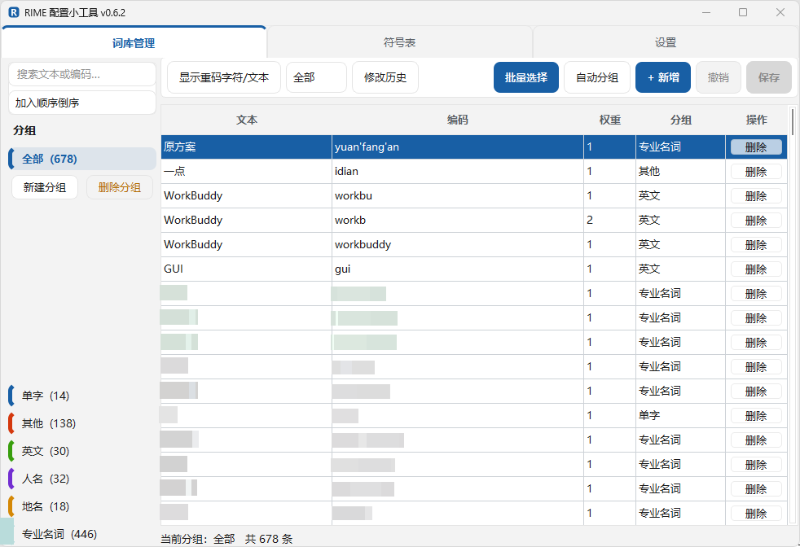

## v0.10.0 更新

- 词典底层升级为第三代分片索引：每个源词典使用独立 SQLite 分片，小型目录库原子切换；词典变更只重建对应分片，查询不再扫描大型原始词典。
- 查询和索引维护使用独立数据引擎，连续搜索只保留最新请求；索引构建延后到系统空闲时执行，构建期间继续使用上一代可用索引。
- 修复词典中心迁移期长期显示“索引正在后台准备”的问题；现有紧凑索引可继续提供按词典分页浏览、精确搜索和“加载更多”。
- 万象更新增加前置确认和应用级冻结提示，明确预计耗时、中文输入暂不可用及输入窗口可能短暂无响应；部署完成后才恢复操作并在空闲时刷新索引。
- 万象更新只写入内容确实变化的官方文件，部署后检查实际构建产物；失败时恢复原版本并重新部署。
- 万象专用输入习惯新增“Caps Lock 直接切换中英文”：锁定后直接输入大写英文，取消锁定后立即恢复中文输入。
- 快速采集选择其他有效编码后可以删除默认编码；无有效编码时仍禁止保存。
- 优化快速调节、候选预览、自动部署与编码建议的后台调度，减少界面阻塞和重复任务。

## v0.9.2 更新

- 快速采集在目标窗口保持不变时增加一次受控复制重试，改善 Chromium 等程序偶尔未及时返回选中文本的问题；仍不附加目标输入线程，采集后恢复原剪贴板。
- 编码输入框只过滤可打印字符，退格、删除和光标编辑恢复为标准输入框行为，同时继续屏蔽中文、全角字符和空白。
- 输入习惯页的“保存并应用”改为明确触发重新部署，不再受全局自动部署开关影响；页面会持续显示正在应用、成功或“已保存但尚未应用”的结果。
- 万象的用户词频、整句和上下文建议等设置只有在部署成功后才标记为已应用，避免配置已写入但当前输入法仍使用旧构建结果。

## v0.9.1 更新

- 词典中心首次目录扫描改为后台执行，并在当前会话缓存各输入方案的目录结果；大型词典不会再在进入页面时长时间占用 GUI 线程。
- 备份恢复增加“恢复前比较”，先展示当前文件与所选备份的增删差异；修改历史开始关联真实写前快照，可安全回滚并自动保护回滚前版本。
- 词库维护新增部署状态中心，可查看任务进度与最近结果并立即重新部署；并发部署请求继续合并为至多一次补跑。
- 跨方案导入可逐项处理“同词同码但内容不同”的词条，默认保留目标方案，也可明确选择采用来源方案内容。
- 词库工作台支持按输入方案保存常用组合筛选，包含搜索词、分组、快速筛选和排序方式。
- 完成资源、错误与写入风险检查；候选窗皮肤编辑继续冻结，本版本不打包、不删除旧索引实现。
- “候选窗外观”已从程序导航和运行时页面中剔除；冻结源码与已有用户配置仍保留，程序不会再实例化该页面。

## v0.8.0 更新

- 主界面按职责扩展为词库工作台、词典中心、词库维护、输入习惯、候选窗外观、符号管理和设置；高频新增、快速调节和保存保持可见，导入、重码、历史与自动分组集中到词库维护。
- 新增字词快速调节：可按完整字词、完整拼音编码及受支持简码查询个人、系统/白霜和万象词典，并以当前输入方案的隔离 Rime 会话显示实际候选。
- 新增词典中心：按当前输入方案列出词典原文件名、用途和类型；固定系统词典只读，安全的个人词典支持暂存编辑后统一保存。
- 系统词典索引改为后台构建，主窗口持续显示阶段、文件和进度；设置页词典扫描和页面切换不再阻塞主界面。
- 浅色、深色和水墨主题统一页面层级、操作栏、保存状态和键盘焦点；修复水墨侧栏选中项文字对比度。

## v0.7.1 更新

- 词库管理页在同一行显示 Rime 当前启用的拼音方案、本页实际编辑的词库文件和识别依据。
- 同时启用多个方案时如实显示完整列表，并将 Rime 记录的历史方案标为“上次使用”。
- “从其他方案导入”改用直观的来源、去向、数量和处理结果；文件路径与校验步骤收纳到可展开的“技术详情”。有待确认内容时导入按钮仍可点击，程序会明确引导勾选确认项。

## v0.7.0 更新

- 新增“跨方案导入”向导，可在白霜与万象的独立 Tab 个人词库之间按当前目标方案安全复制缺少词条。
- 白霜与万象之间可按当前目标方案双向复制缺少的个人词条；来源始终只读，两套方案仍使用各自独立词库。
- 导入前检查格式、特殊编码、动态短语和冲突，提交时创建事务快照、检测外部修改、重新部署并验证生效配置。
- 万象候选预览在应用专用隔离环境中运行，不再以白霜候选结果或静态词典排序代替实际结果。

## v0.6.5 更新

- 设置页在“开机自动启动”勾选框后显示 Windows 实际启动项状态，明确区分已启用、未启用、被系统禁用及异常情形。
- 取消开机自启动后改为即时更新状态，不再显示会阻塞设置页的确认对话框；启用失败时不会重复触发关闭操作。
- 已启用自启动的目录便携版移动到新位置后，会在下次启动时校验旧快捷方式并自动修复为新路径。

## v0.6.4 更新

- 备份采用“原文件名_日期时间.bak”，兼容识别和恢复历史备份。
- 单文件版与目录便携版可分别检查、下载和替换对应更新包。
- 目录便携包的主题与勾选图标改为内置资源，移动到中文、空格或特殊字符路径后仍可正常显示。
- 开机自启动会校验 Windows 启动项状态、快捷方式目标和最小化启动参数。

## 为自己的输入习惯，打造一套个人词库

Rime 是一款优秀的本地离线输入法。它轻量、可定制、没有商业广告，词库和配置由用户自己掌控，适合重视输入体验、资源占用和个人数据边界的用户。

Rime 的自定义能力非常强大。它使用可读的文本配置和词库文件，支持方案组合、版本管理、脚本化维护和深度定制，因此尤其适合程序员、技术人员，以及希望掌控输入法行为的进阶用户。

但本地输入法也有天然的取舍：它没有大型商业输入法长期积累的云端词库、在线联想和自学习能力。即使使用成熟的 Rime 方案，其基础词库通常仍以公开词库为主；面对个人职业领域、工作环境、常用表达和输入习惯时，候选结果未必总能贴合实际需求。

每个人都会有一套属于自己的词汇：专业术语、项目名称、固定短语、人名地名、常用英文，以及工作和生活中反复输入的内容。它们未必适合进入公共词库，却非常值得沉淀为自己的个人词库。

随着使用时间增长，个人词库会不断积累。那些反复输入的专业术语、固定表达和个人习惯用语逐渐被收录后，输入体验也会越来越贴合自己。个人词库不应是一次性配置，而应当是一项可以长期建设、持续优化的个人资产。

## 为什么需要这个工具

Rime 本身缺少面向日常维护的图形化配置界面。很多人希望快速完成具体任务，而不是先了解和掌握输入方案的机制与原理。这种门槛可能也是 Rime 目前仍属于偏小众输入法的原因之一。

RIME 配置小工具最初也是为解决这一痛点而开发。它尝试为个人词库维护建立一个直观的图形化配置界面，在保留 Rime 本地化、可控和强大定制能力的同时，把高频的个人词库维护操作变得更容易理解和使用。

工具将“发现一个常用词”到“它按合适的编码和候选位置出现在输入法中”的过程，尽量缩短为一次采集、确认和保存；再通过多编码、权重、候选预览、重码管理、分组、批量操作、备份恢复等能力，让个人词库可以长期积累，而不必频繁手工编辑 Rime 配置文件。

## 从选中文字到个人词库

在工作、浏览或阅读时，用鼠标选中希望收入个人词库的字词。无论是汉字、英文、数字，还是它们的混合组合，只需按下设置好的全局快捷键，即可打开采集窗口并保存到个人词库。

保存后，工具可自动刷新 Rime 部署，使新增词条尽快生效。用户还可以编辑词条权重，控制它在相同编码候选中的排序位置，让常用内容更容易被优先输入。

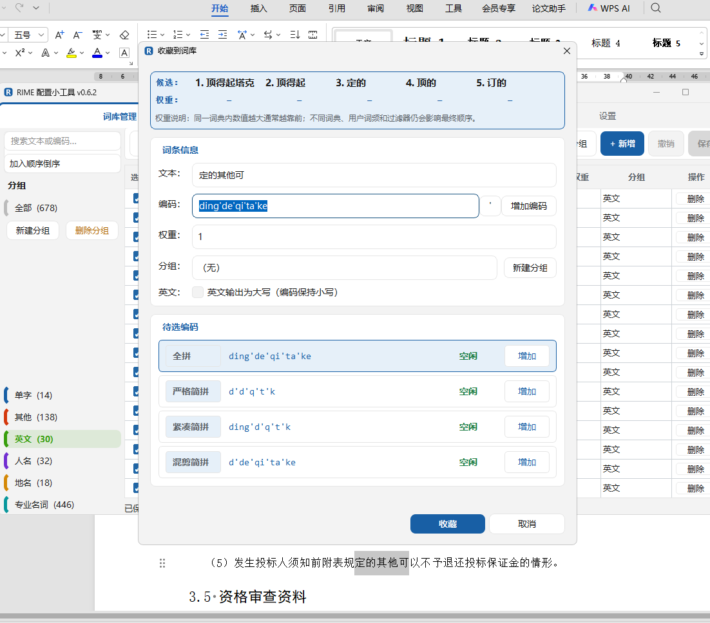

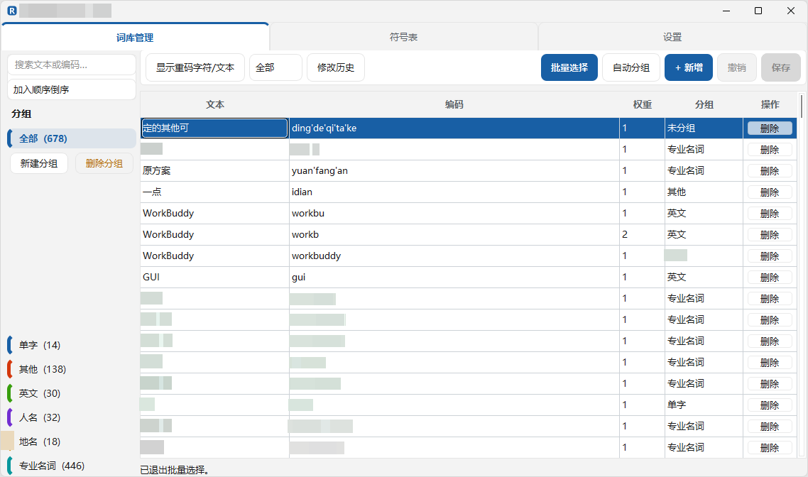

### 候选与权重预览

采集和编辑窗口会按当前 Rime 的每页候选数显示独立会话候选，以及可读取的系统词典或自定义词权重。当前正在采集或编辑的文本会使用主题强调色标记。候选预览仅用于辅助判断，不会改变正在使用的输入法。

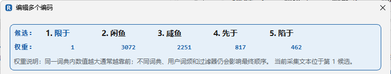

## 主要功能

### 词库管理与批量维护

- 搜索、排序、分组和筛选词条。
- 直接编辑文本、编码和权重。
- 批量选择、批量删除、批量调整分组。
- 分组显示条目数量，便于整理个人词库。
- 提供词库检查、修改历史和导入导出能力。

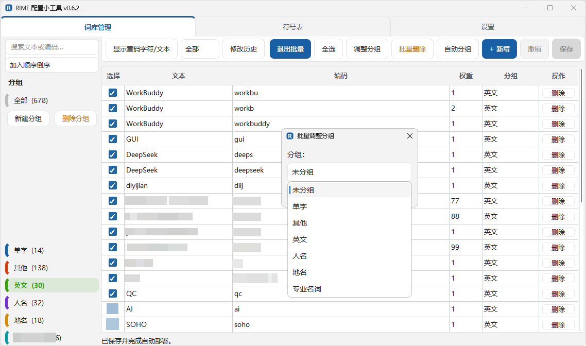

### 多编码维护

同一文本支持多个编码。双击词条可集中维护已有编码，也可从全拼、严格简拼、紧凑简拼和混剪简拼建议中一键加入新编码。

纯英文文本可选择小写、大写或原样编码；英文短语会自动移除空格和连字符，生成连续编码。

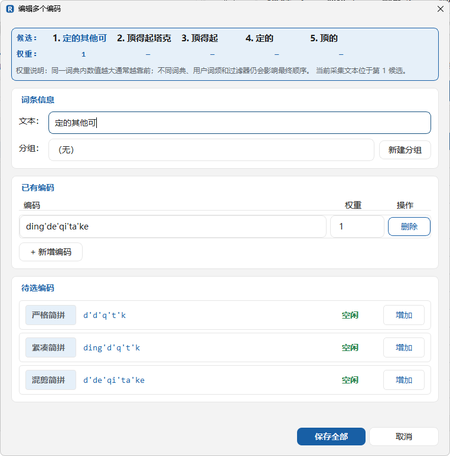

### 重码集中管理

可按“重码文本”或“重码拼音”查看全库冲突。双击项目后，可在二级窗口集中修改文本、编码和权重，或暂存删除项目；点击“保存全部”后才会统一写入词库。

| 按重码文本浏览 | 集中编辑重码文本 |
| --- | --- |
| 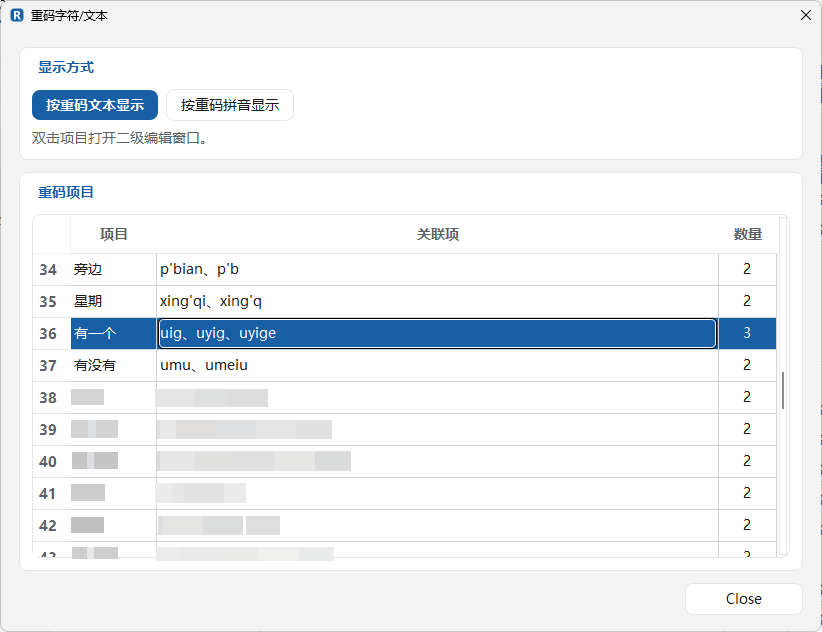 | 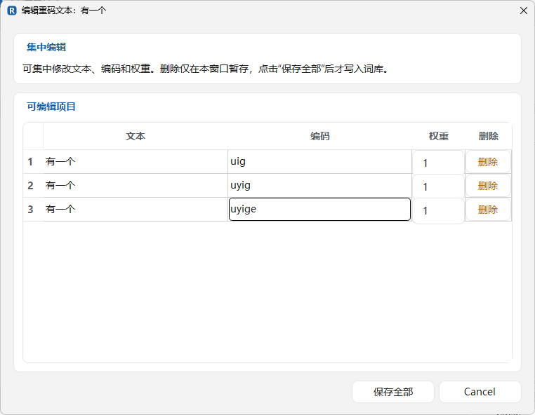 |
| 按重码拼音浏览 | 集中编辑重码拼音 |
| 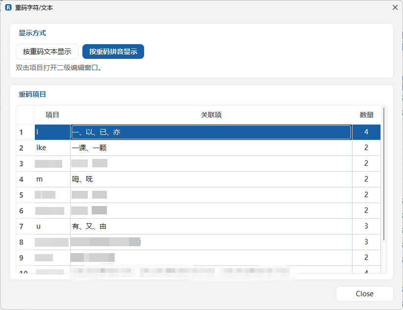 | 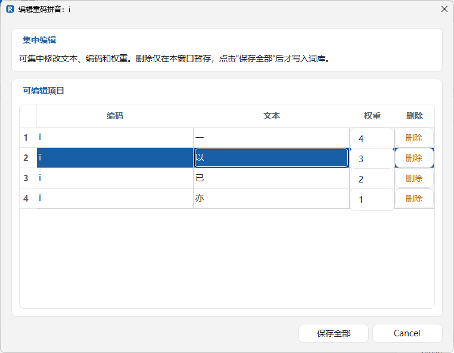 |

### 备份与恢复

- 关键保存前自动备份受管文件。
- 支持立即备份、定期备份、自定义备份周期和保留份数。
- 支持自动清理旧备份，并可直接打开备份文件夹。
- 可选择历史版本恢复词库短语、输入方案和符号表。

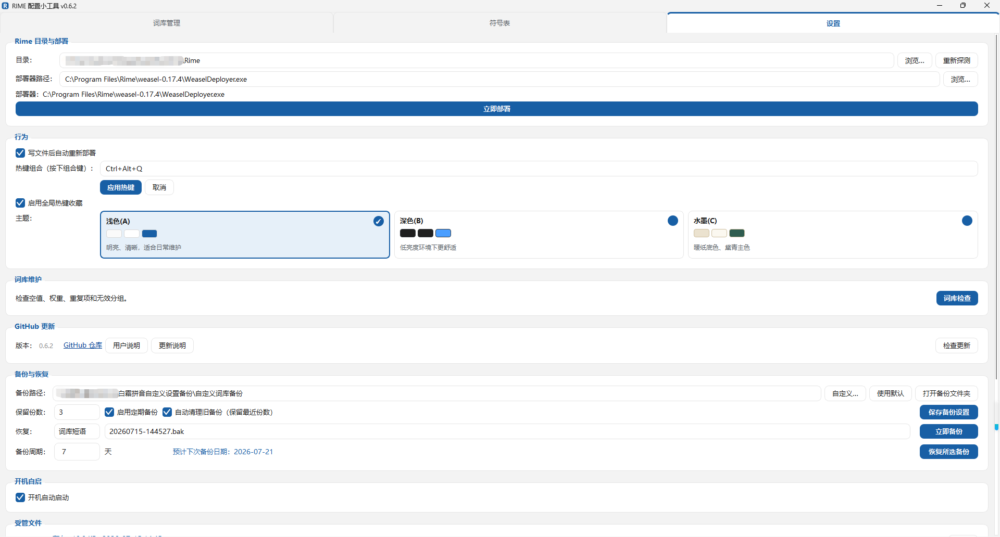

### 托盘、部署与主题

- 系统托盘常驻，关闭窗口后仍可随时打开。
- 支持开机自启、立即重新部署和保存后自动部署。
- 单实例保护：重复启动时会恢复已运行窗口。
- 提供浅色、深色和水墨三种主题。

<p align="center">
  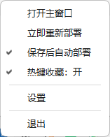
</p>

| 深色主题 | 水墨主题 |
| --- | --- |
| 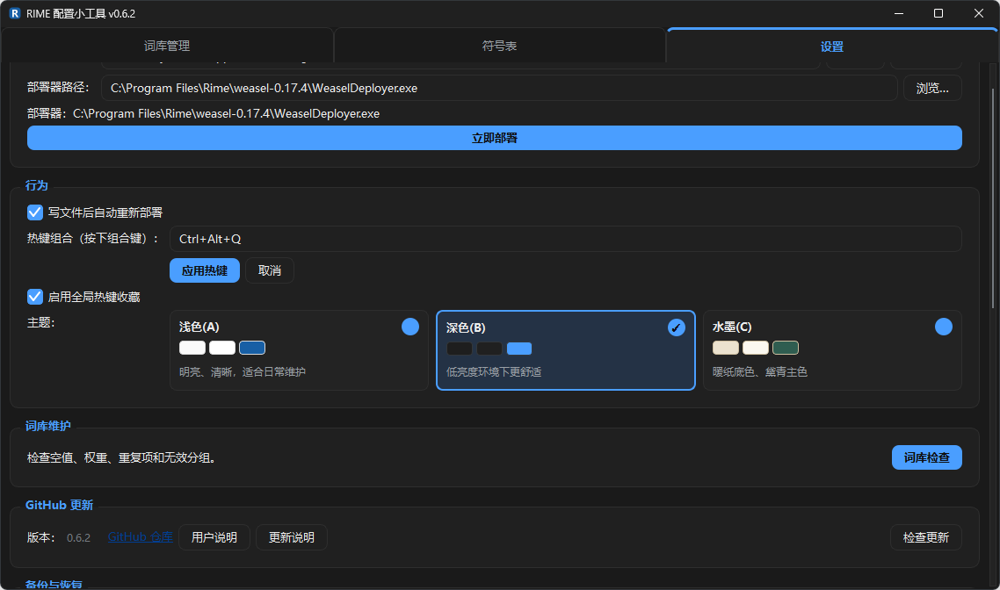 | 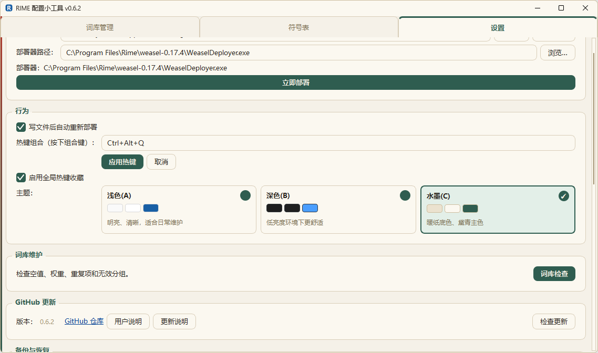 |

## 下载与运行

前往 [GitHub Releases](https://github.com/ysbushe/rime-config-tool/releases/latest) 下载适合自己的 Windows 发布包：

| 文件 | 适用方式 |
| --- | --- |
| `RimeConfig.exe` | 单文件版。无需安装，双击即可运行；支持应用内“检查更新”。 |
| `RimeConfig-portable.zip` | 目录式便携版。解压后运行其中的 `RimeConfig.exe`。 |

程序面向 Windows 10/11 和小狼毫 Rime 用户。首次启动时会自动尝试寻找 Rime 用户目录；未识别时，可在“设置”页面手动选择。

## 基本使用流程

1. 打开“设置”，确认 Rime 用户目录有效。
2. 在“词库管理”中维护已有词条、分组和权重。
3. 在工作或浏览时选中文字，使用全局热键打开采集窗口。
4. 选择合适的编码建议、分组和权重后保存。
5. 根据需要立即部署，或启用保存后自动部署。
6. 使用重码管理、批量操作和备份恢复持续整理词库。

完整使用说明见 [用户说明](docs/USER_GUIDE.md)，历次变更见 [更新记录](docs/RELEASE_NOTES.md)。

## 受管文件

程序主要维护以下 Rime 文件：

- `custom_phrase.txt`：自定义短语、编码和权重。
- `wanxiang_user_phrase.txt`：万象拼音独立自定义短语目标，由跨方案导入事务维护。
- `wanxiang.custom.yaml`：导入时仅维护 `custom_phrase/user_dict` 挂载，其他配置原样保留。
- `rime_frost.schema.yaml`：输入方案信息与部署检测。
- `symbols_v.yaml`：符号表分类与条目。
- `pinyin_display.ini`：本工具保存的拼音显示分隔信息。

词库仍以 Rime 兼容的 UTF-8 无 BOM、Tab 分隔格式写入：

```text
文本    编码    权重
```

## 开发与测试

```powershell
python -m venv .venv
.\.venv\Scripts\python.exe -m pip install -r requirements-dev.txt
.\.venv\Scripts\python.exe -m pytest -q
.\.venv\Scripts\python.exe -m src.main
```

单文件打包：

```powershell
.\.venv\Scripts\python.exe -m PyInstaller --noconfirm --clean build.spec
```

目录式打包：

```powershell
.\.venv\Scripts\python.exe -m PyInstaller --noconfirm --clean RimeConfig-dir.spec
```

## 版本与说明

当前版本：`v0.10.0`

- [用户说明](docs/USER_GUIDE.md)
- [更新记录](docs/RELEASE_NOTES.md)
- [GitHub Releases](https://github.com/ysbushe/rime-config-tool/releases/latest)
### 按需输入诊断程序

输入诊断已剥离为独立的 `RimeInputDiagnostics.exe`。主程序启动后不会加载或运行监控；只有在“设置 → 输入诊断（按需运行）”中点击“启动输入诊断”时才会拉起，关闭诊断窗口后监控随即停止。

诊断日志位于 `%LOCALAPPDATA%\RimeConfig\diagnostics\input-events.jsonl`，超过 2 MB 自动轮换。日志只包含进程名、窗口类与矩形、前台进程、鼠标位置和 Ctrl/Alt/Shift/Win 状态；不会读取窗口标题、实际按键、剪贴板或 Rime 组词内容。
